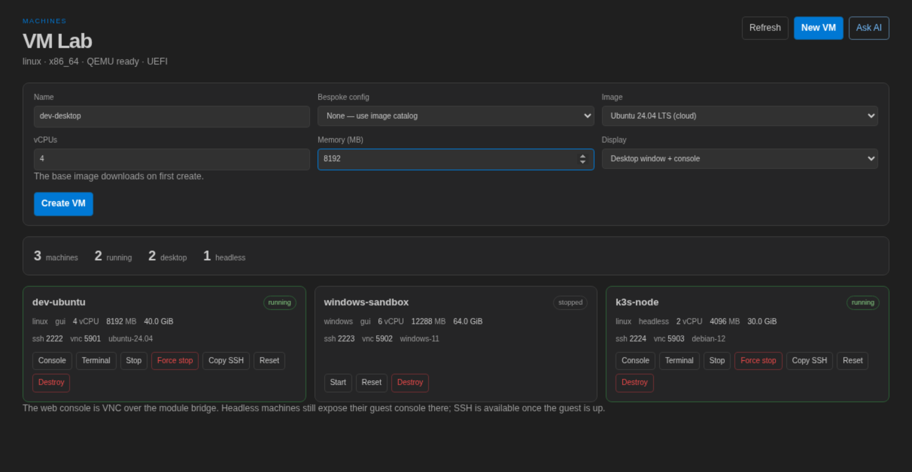

<p align="center">
  <a href="https://orqella.io">
    
  </a>
</p>

<h1 align="center">VM Lab</h1>

<p align="center">
  <a href="https://orqella.io">Website</a> ·
  <a href="https://github.com/orqella/orqella#install">Quick start</a> ·
  <a href="https://github.com/orqella/orqella#modules">Modules</a> ·
  <a href="https://github.com/orqella/orqella#desktop-client">Desktop client</a> ·
  <a href="https://orqella.io/docs/">Documentation</a>
</p>



A portable QEMU VM manager for Orqella.

## What it does

- Lists, creates, starts, stops, resets, and destroys local VMs. **Stop** asks
  the guest to shut down and then forces QEMU off after a few seconds;
  **Force stop** skips the graceful wait.
- Creates Linux cloud-image VMs with cloud-init, or boots a Linux/Windows ISO
  through the browser console.
- Windows guests use IDE disks and Intel `e1000` networking so Windows Setup can
  see the target disk without virtio drivers.
- Windows ISO creation can generate an unattended-answer floppy. The guest gets
  a local administrator named `orqella` with a generated password (or the
  password you supply), bypasses Windows 11 compatibility
  checks, and enables OpenSSH on first logon.
- Supports a prepared disk image as the backing image.
- Gives every running VM a VNC console through the Orqella module websocket
  bridge and an SSH terminal when the guest exposes SSH.
- Stores VMs, images, keys, and metadata under the module's `data/` directory.
- Keeps the existing module data when the module is reinstalled.

## Host requirements

- QEMU for the host:
  - Linux: `qemu-system-x86_64`/`qemu-system-aarch64`, `qemu-img`, and ideally
    `/dev/kvm`.
  - macOS: Homebrew QEMU (`brew install qemu`); macOS guests require a macOS
    host and are not automatically installed.
  - Windows: QEMU for Windows with `qemu-system-x86_64.exe` and `qemu-img.exe`
    on `PATH`.
- `ssh-keygen`; `ssh` is needed for the web terminal.
- OVMF/edk2 for UEFI guests such as Windows 11.

The module Settings tab can override the QEMU binary paths and default CPU,
memory, and display settings.

## AI-prepared recipes

**Ask AI** next to **New VM** sends a prompt to Orqella's configured default
agent with the VM Lab data directory as its working root. Orqella opens the
agent's conversation in the configured viewer (OpenCode by default) instead of
showing a scrolling log. The agent reads `data/AGENT.md`, writes reusable
recipes under `data/recipes/`, and can download images into `data/images/`. Once
a recipe exists it appears in the **Bespoke config** selector on the New VM form.
Recipes can set the image, CPU/memory, disk size, display mode, extra cloud-init
YAML, and SSH provisioning commands.

## Catalog

The first run creates `data/catalog.json`. Edit it (or ask the Orqella agent to)
to add distributions, local ISO paths, or existing disks. Built-in entries:

- Ubuntu 24.04 cloud image (downloaded on first create)
- Debian 12 cloud image (downloaded on first create)
- Linux ISO and Windows 11 ISO (manual install)
- Prepared macOS disk (macOS hosts only; experimental)
- Existing qcow2/raw disk

Each VM is a qcow2 overlay over its base image. Cloud images receive an SSH key
and cloud-init data over QEMU's user network. Installer ISOs are attached to the
VM; install through the console, then press **Finish install** to detach the
installer and boot the installed disk.

Cloud images download into `data/images/` on first create. Remote image URLs
must use HTTPS; loopback HTTP mirrors are allowed. A catalog entry or recipe may
set `sha256` to a 64-character digest, which is checked for both downloads and
cached files. Downloads are capped at 16 GiB and a short read fails the job. The
built-in cloud entries follow moving "latest" URLs, so they do not pin a
digest; pin a copy with `sha256` when reproducibility matters.

## Display modes

- **Desktop window + console**: opens the normal QEMU window and also exposes a
  browser VNC console.
- **Headless + console**: no local QEMU window; use the browser console or SSH.

The console is available for both modes. For Linux cloud images, cloud-init
configures the SSH key and user, so the terminal is usable once boot completes.
Windows terminal support depends on the guest having OpenSSH enabled. The
console and terminal open in nested module frames; the VM Lab page relays the
Orqella SDK for those frames and passes the module WebSocket token in their URL.

`ui/console.bundle.js` is generated from `ui/console.js` and the vendored noVNC
sources. Rebuild it after changing the console:

```bash
npx esbuild ui/console.js --bundle --format=esm --platform=browser \
  --target=es2022 --outfile=ui/console.bundle.js
```

QEMU's default user network forwards TCP SSH only. VM metadata may add UDP
forwards for guest services that need inbound UDP, such as an Orqella Link
endpoint on a testbed:

```json
"udp_forwards": [
  {"host": "192.168.68.10", "host_port": 7842, "guest_port": 7842}
]
```

This creates `hostfwd=udp:<host>:<host_port>-:<guest_port>`. The guest still
needs to bind the matching port and advertise the host-side address. UDP
forwards are limited to the configured ports; they are not a general bridged
LAN connection.

## Platform notes

QEMU is the common backend, but hardware acceleration is host-dependent:
KVM on Linux, HVF on macOS, and WHPX on Windows. The module falls back to TCG
when hardware acceleration is unavailable; this is functional but slower.

macOS guests are gated to macOS hosts. Automating macOS guest creation is out
of scope for this version because it requires Apple-specific virtualization and
licensing constraints. The module accepts a prepared disk only.

Windows 11 may require TPM/Secure Boot configuration; this version provides the
UEFI path but does not auto-create a TPM. Customize the VM/catalog for stricter
Windows requirements.

Windows unattended installation is available when creating an ISO VM: enable
**Unattended Windows install** in the New VM form. The local administrator
password is the value you enter; if you leave it blank the sidecar generates a
random password and prints it once in the create log. It is stored only in the
VM's `data/vms/<name>/meta.json` and unattended files, all mode 0600. This has
been validated with
Windows 11 Enterprise Evaluation 24H2 on a BIOS-compatible QEMU setup. UEFI CD
boot of that evaluation ISO currently fails under OVMF; investigate that before
making UEFI the default for Windows guests. The manual install path also remains
available.

Automatic macOS guest creation is deliberately deferred. macOS guests require a
macOS host and a prepared disk; the module accepts that disk but does not create
or provision it.

## Security

QEMU guest memory is allocated by the guest process and is not capped by the
sidecar `max_memory_mb` policy; plan host memory separately from the sidecar
limit.

The sidecar runs unsandboxed because it must launch QEMU, manage disks, and
listen on loopback ports for VNC/SSH. VNC listens only on loopback and requires
the per-VM password that the sidecar sets through QMP and returns to the module
page; do not expose the port beyond loopback. On Windows the QMP endpoint is a
loopback TCP socket without authentication, so any local user can control that
VM. Treat that as a Windows-only residual risk; Unix hosts use a mode-0600 Unix
socket. VM metadata, unattended files, seed data, and images are mode
0600/0700 under `data/`.
